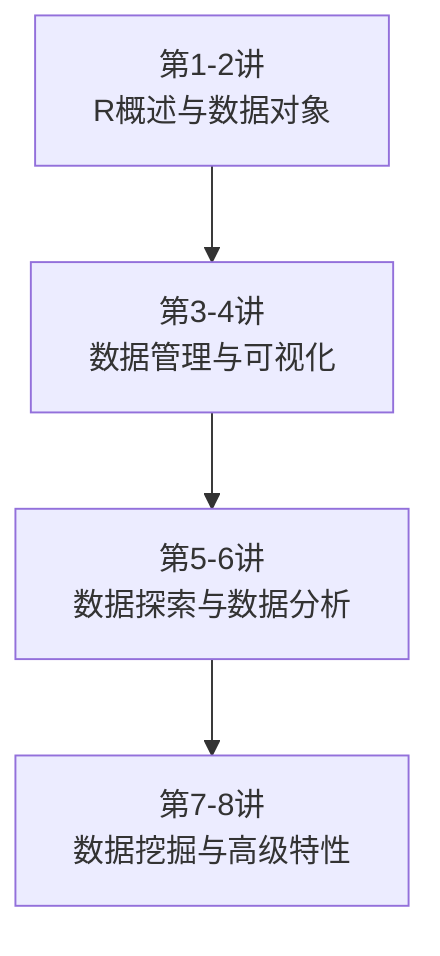

# 第九讲 Python快速入门与Pandas基础
## Python Quick Start and Pandas Basics

---
layout: default
---

# 本讲学习目标 Learning Objectives

**Knowledge**
- 掌握 Python 基本数据类型与核心数据结构（列表、元组、字典、集合），能与 R 建立对照
- 理解缩进即语法；掌握条件、循环、函数定义
- 掌握 Pandas 中 Series 与 DataFrame 核心概念

**Ability**
- 配置 conda + Jupyter 环境，创建并运行 Notebook
- 用 `pd.read_csv()` 读取医学数据，`head/info/describe` 探查
- 完成选择列、布尔筛选、缺失值处理

**Thinking**
- 跨语言思维：避免"用R的思维写Python"

<!-- notes: 前测（举手调查）：用过Jupyter的？写过Python的？被缩进坑过的？根据举手情况调整模块一节奏。-->

---
layout: table-of-contents
contentTitle: '目录 | Contents'
contentItems:
  - 从R到Python：为什么再学一门语言
  - Python环境与Jupyter Notebook
  - Python基础语法（R对照速成）
  - Pandas入门：Series与DataFrame
  - 医学数据读写与探查实战
  - 总结与作业
---

<!-- notes: 六个模块。上半节：动机+环境+语法；下半节：Pandas全家桶+实战。-->

---
layout: section
sectionNumber: 1
sectionTitle: '从R到Python'
sectionTitleEn: 'From R to Python'
---

---
layout: default
hideFrame: true
---

# 前8讲回顾：R语言半程

<div class="hebmu-columns">

<div>



</div>

<div class="mt-2">

**你已具备**：

- 向量与数据框操作（`c` / `matrix` / `data.frame`、索引、`subset`）
- 多表合并与分组汇总（`merge`、`aggregate`、`melt` / `dcast`）
- base 绘图 `plot()` 与 ggplot2 入门（iris 案例）
- 统计与挖掘初体验（t 检验、方差分析、线性回归、K 均值）

</div>

</div>

<!-- notes: 一句话总结R半程：R帮我们完成了从数据对象到统计与数据挖掘的完整训练。今天开启Python半程，同样8讲+2次实验。注意口径：R半程是base R为主（merge/aggregate/melt），未讲dplyr/R Markdown/pheatmap——第16讲Jupyter补可重复报告，tidyverse只在对照表作延伸阅读。-->

---
layout: default
hideFrame: true
---

# 既然R这么好用，为什么还要学Python？

<v-clicks>

- **工作流语言**：Snakemake（Python）/ Nextflow（Groovy）；步骤里常跑 Python 工具
- **机器学习通用语**：scikit-learn、PyTorch；AlphaFold 是 Python 写的
- **Biopython**：读 FASTA/GenBank、序列对象与注释、本地/远程 BLAST
- **工程化能力**：爬虫(crawling)、网页后端(backend)、自动化脚本(automation script)
- **实验室现实**：你未来的课题组，大概率 R 和 Python 都在用

</v-clicks>

<div
  class="hebmu-callout hebmu-callout-key mt-4"
  v-click
  v-motion
  :initial="{ opacity: 0, y: 16 }"
  :enter="{ opacity: 1, y: 0 }"
>

**两门语言的真实分工**：R 管统计与出版级图形；Python 管建模、流程与工程化

</div>

<!-- notes: 提问1：大家做R作业时，有没有遇到R做不了或很难做的事？收集1-2个回答。提问2（铺垫）：R里 sapply(x, sqrt) 这种写法，Python里对应什么？——列表推导式页呼应作答。思政点（模块一1.1口头带过）：Python 正成为医学信息学"通用语言"——开放、免费、社区驱动，降低全球科研门槛。-->

---
layout: section
sectionNumber: 2
sectionTitle: 'Python环境与Jupyter Notebook'
sectionTitleEn: 'Environment & Jupyter'
---

---
layout: default
hideFrame: true
---

# Anaconda / Miniconda：安装与环境

```bash
# 推荐：Anaconda（全家桶）或 Miniconda（轻量）
conda create -n bioinfo python=3.12    # 创建独立环境
conda activate bioinfo                 # 激活
python --version                       # 验证

# 安装本课程常用库
conda install pandas numpy matplotlib seaborn jupyterlab biopython scikit-learn
```

<div class="hebmu-callout hebmu-callout-warning mt-4">

**conda 环境 = 独立工具箱**：一门课一个环境，互不干扰。⚠️ 不要装完官方原版 Python 就直接用

</div>

<div class="mt-3 flex items-center gap-8 flex-wrap">

<a href="https://www.anaconda.com/" target="_blank" class="inline-flex items-center gap-3 no-underline text-inherit">
  
  <span>Anaconda 官网</span>
</a>
<a href="https://docs.astral.sh/uv/" target="_blank" class="inline-flex items-center gap-3 no-underline text-inherit">
  
  <span>uv</span>
</a>
<a href="https://pixi.sh/" target="_blank" class="inline-flex items-center gap-3 no-underline text-inherit">
  
  <span>pixi</span>
</a>

</div>

<div class="hebmu-callout hebmu-callout-check mt-2">

本课统一用 **conda**；uv / pixi 是近年流行的包与环境管理工具，课后可自行了解

</div>

<!-- notes: 预习检验：已装好的同学核对版本；没装好的课后先完成作业1。延伸：uv（Astral）偏快安装与脚本；pixi（prefix.dev）偏 conda 生态的跨平台锁定——本课作业与实验仍以 conda + bioinfo 环境为准。-->

---
layout: default
hideFrame: true
density: compact
---

# Jupyter Lab：生信分析标准工具

在命令输入`jupyter lab`启动, 浏览器自动打开｜ 单元格：Code / Markdown / Raw

| 快捷键 | 作用 | 快捷键 | 作用 |
|------|------|------|------|
| `Shift+Enter` | 运行并下移 | `Ctrl+Enter` | 运行不移动 |
| `Esc → A / B` | 上/下插入单元格 | `Tab` | 自动补全 |
| `Shift+Tab` | 查看文档 | `Esc → M / Y` | 切换Markdown/Code |

<div class="hebmu-callout hebmu-callout-check mt-3">

单元格只显示**最后一个表达式**的值 —— 多行结果想都看到，用 `print()`

</div>

<div class="hebmu-callout hebmu-callout-key mt-2">

**另一套常用体系（课后可练）**：VS Code 或 Cursor + Jupyter 扩展 —— 在编辑器里直接打开 `.ipynb`，同样能跑单元格；课上演示仍以浏览器中的 Jupyter Lab 为准

</div>

<!-- notes: 对照预习视频检验：Tab补全和Shift+Tab看文档是Jupyter效率核心，现场演示一次 jupyter lab。不提 RStudio/R Markdown——R半程未教。课上/作业默认浏览器 Jupyter Lab；VS Code/Cursor 仅作延伸。-->

---
layout: section
sectionNumber: 3
sectionTitle: 'Python基础语法'
sectionTitleEn: 'Python Basics: R对照速成'
---

---
layout: default
hideFrame: true
density: compact
---

# 变量与基本数据类型

<div class="hebmu-columns">

<div>

**Python**

Input:
```python
age = 61                 # int
egfr_expr = 8.52         # float
gene = "EGFR"            # str
is_mutated = True        # bool

type(gene)
```
Output:

````md magic-move
```

```
```
<class 'str'>
```
````

</div>

<div>

**R**

Input:
```r
age <- 61L               # integer
egfr_expr <- 8.52        # numeric
gene <- "EGFR"           # character
is_mutated <- TRUE       # logical

class(gene)
```
Output:

````md magic-move
```

```
```
[1] "character"
```
````

</div>

</div>

<v-clicks>

- **动态类型(dynamic typing)**：类型跟着值走，变量无需声明；`age = "61岁"` 合法但危险
- 类型转换：`int("61")`、`str(8.52)`、`float("3.14")`

</v-clicks>

<div
  class="hebmu-callout hebmu-callout-key mt-3"
  v-click
  v-motion
  :initial="{ opacity: 0, y: 16 }"
  :enter="{ opacity: 1, y: 0 }"
>

快问快答：`"61" + 1` → R 报错；Python 直接 `TypeError`

</div>

<!-- notes: 双栏对照：左 Python / 右 R。先问 type(gene) / class(gene)，再各点一次让两侧 Output morph。动态类型与 TypeError 由现场⏸错误演示（notebook）承接。-->

---
layout: default
hideFrame: true
---

# 四大核心数据结构（R对照）

| Python | 写法 | 特点 | R对照 |
|------|------|------|------|
| 列表 list | `xs = [3, 5, 7]` | 有序、可变 | 向量（可混类型）`c(3, 5, 7)` |
| 元组 tuple | `t = (3, "EGFR")` | 有序、**不可变** | 无直接对应 |
| 字典 dict | `d = {"gene": "EGFR"}` | 键值对 | 命名列表 `list(gene="EGFR")` |
| 集合 set | `s = {3, 5, 5, 7}` | 无序、去重 | `unique(c(3, 5, 5, 7))` |

<div
  class="hebmu-callout hebmu-callout-key mt-4"
  v-click
  v-motion
  :initial="{ opacity: 0, y: 16 }"
  :enter="{ opacity: 1, y: 0 }"
>

**帮助记忆的对应关系**：列表≈向量、字典≈命名列表、集合≈`unique()` 去重结果；元组=只读列表

</div>

<!-- notes: 强调这四个结构以后天天用，尤其列表和字典。-->

---
layout: default
hideFrame: true
---

# 列表：最常用的数据结构

Input: 
```python
expr = [8.5, 2.1, 9.7, 4.3]

expr[0]            # —— 第1个元素（R: expr[1]）
expr[1:3]          # —— 含头不含尾（R: expr[2:3]）
expr[-1]           # —— 倒数第1个
expr.append(6.0)   # 追加（R: c(expr, 6.0)）
len(expr)          # 长度（R: length(expr)）
```
Output:

````md magic-move
```

```
```
8.5
[2.1, 9.7]
4.3
5
```
````

<v-clicks>

<div class="hebmu-callout hebmu-callout-warning">

⚠️ **0-based** :python 索引从 0 开始（R 从 1 开始）
**口诀**：切片 `[a:b]` **含头不含尾**（取 a 不取 b）

</div>

</v-clicks>

<!-- notes: 这是R用户第一大坑。先让学生猜 expr[0]、expr[1:3]、expr[-1] 的值（0-based是本页核心提问），回答后点击 morph 出纯结果（8.5 / [2.1, 9.7] / 4.3 / 5；append 返回 None，不显示）。切片含头不含尾要重复强调。⏸ 演示：expr[99] 索引越界 IndexError——先让学生预测再运行，归入运行时错误。-->

---
layout: default
hideFrame: true
---

# 字典：键值对映射

Input: 
```python
patient = {"id": "LC001", "age": 61, "stage": "IIIB"}

patient["age"]         # —— 按键取值
patient["sex"] = "M"   # 新增键值对
print(patient)         # 查看整个字典
list(patient.keys())   # —— 注意插入顺序
```
Output:

````md magic-move
```

```
```
61
{'id': 'LC001', 'age': 61, 'stage': 'IIIB', 'sex': 'M'}
['id', 'age', 'stage', 'sex']
```
````

<div
  class="hebmu-callout hebmu-callout-key mt-3"
  v-click
  v-motion
  :initial="{ opacity: 0, y: 16 }"
  :enter="{ opacity: 1, y: 0 }"
>

类比：字典 = 贴了标签的抽屉柜 | 临床数据按字段名组织，按键取值比按位更加自然

</div>

<!-- notes: 字典是后面DataFrame列操作、JSON处理的基础。提问patient["age"]、新增后 print(patient)、keys()插入顺序，再点击 morph。KeyError现场⏸错误演示在notebook。-->

---
layout: default
hideFrame: true
---

# 条件与循环：缩进即语法

```python
if egfr_expr > 7.0:
    print("高表达")        # 冒号 + 4空格缩进，没有花括号！
elif egfr_expr > 3.0:
    print("中表达")
else:
    print("低表达")

for g in ["EGFR", "ALK", "KRAS"]:
    print(g)

for i in range(3):        # 0, 1, 2 —— 还是从0开始
    print(i)
```

<div
  class="hebmu-callout hebmu-callout-warning mt-2"
  v-click
  v-motion
  :initial="{ opacity: 0, y: 16 }"
  :enter="{ opacity: 1, y: 0 }"
>

R 习惯三大坑：**忘冒号、忘缩进、写花括号**；运算符坑：幂是 `**` 不是 `^`（`^`是XOR）

</div>

<div
  class="hebmu-callout hebmu-callout-check mt-3"
  v-click
  v-motion
  :initial="{ opacity: 0, y: 16 }"
  :enter="{ opacity: 1, y: 0 }"
>

**错误三分法**（Think Python ch2.9）：语法错误（没运行就拦下）· 运行时错误（TypeError / IndexError / KeyError）· 语义错误（不报错但结果错）

</div>

<!-- notes: while 循环写法一般了解即可（考试很少涉及，口头带过）。教法（预测→运行）：notebook 4 处 ⏸ 先让学生同桌猜"输出什么还是报什么错"（各30秒），再运行、当场归入三分法；收尾快问："这4个报错各属哪类？" -->

---
layout: default
hideFrame: true
density: compact
---

# 函数定义：以GC含量为例

Input: 
```python
def gc_content(seq, digits=1):         # R: gc <- function(seq) {...}
    """计算DNA序列的GC含量(%)"""       # docstring —— R 无对应
    seq = seq.upper()
    gc = seq.count("G") + seq.count("C")
    return round(gc / len(seq) * 100, digits)

gc_content("ATGGCGTAA")                # 省略 digits → 用默认值 1
gc_content("ATGGCGTAA", 2)             # 位置：第1个→seq，第2个→digits
gc_content(seq="ATGGCGTAA", digits=2)  # 关键字：按名字传
gc_content(digits=2, seq="ATGGCGTAA")  # 关键字：顺序可对调，结果相同
```
Output:

````md magic-move
```

```
```
44.4
44.44
44.44
44.44
```
````

<div
  class="hebmu-callout hebmu-callout-key mt-2"
  v-click
  v-motion
  :initial="{ opacity: 0, y: 16 }"
  :enter="{ opacity: 1, y: 0 }"
>

3种传参：位置(positional)靠**顺序** · 关键字(keyword)靠**名字**（可对调）· 默认(default)可省略

</div>

<div
  class="hebmu-callout hebmu-callout-check mt-2"
  v-click
  v-motion
  :initial="{ opacity: 0, y: 16 }"
  :enter="{ opacity: 1, y: 0 }"
>

这个函数在**实验课**和<strong>第15讲（序列绘图）</strong>还会用到 —— 函数是复用单元

</div>

<!-- notes: 先问 gc_content("ATGGCGTAA")→44.4，再问传 2 位小数会怎样→44.44；点出：单参数看不出位置，必须两个参数才体现“第几个进谁”。关键字对调那一行专门证明顺序可变。*args/**kwargs 本讲不展开。顺带：①注释解释 why 而非 what（ch2.8）；②// 整除：85 // 2 → 42。-->

---
layout: default
hideFrame: true
density: compact
---

# 列表推导式：对应 R 的向量化写法

<div class="hebmu-columns">

<div>

**Python**

Input:
```python
[gc_content(s) for s in ["ATGC", "GGCC"]]
```
Output:

````md magic-move
```

```
```
[50.0, 100.0]
```
````

</div>

<div>

**R**

Input:
```r
sapply(c("ATGC", "GGCC"), gc)
```
Output:

````md magic-move
```

```
```
[1]  50 100
```
````

</div>

</div>

<div
  class="hebmu-callout hebmu-callout-check mt-3"
  v-click
  v-motion
  :initial="{ opacity: 0, y: 16 }"
  :enter="{ opacity: 1, y: 0 }"
>

Python有更快的向量化方案（NumPy）—— 下一讲介绍

</div>

<!-- notes: 回应导入：sapply ↔ 列表推导式。双栏各点一次 morph。本页约1分钟，不展开；想深挖的拍这页。先问两序列 GC，再出结果。-->

---
layout: default
hideFrame: true
density: compact
---

# 想知道更多？Think Python 3e

<div class="hebmu-columns is-centered">

<div class="flex flex-col items-center">


<div class="hebmu-source text-center">

Think Python 3E · Allen Downey · [免费在线](https://allendowney.github.io/ThinkPython/)（Colab / 本地可跑）

</div>

</div>

<div>

本讲高度相关章节：

- **ch2 Variables and Statements**
- **ch3 Functions**
- **ch4 Functions and Interfaces**
- **ch5 Conditionals and Recursion**
- **ch7 Iteration and Search**
- **ch8 Strings and Regular Expressions**
- **ch9 Lists**
- **ch10 Dictionaries**

</div>

</div>

<div class="hebmu-callout hebmu-callout-check mt-2">

延伸：`gc_content` 这类序列处理思路见 **ch8**；列表深化见 **ch9**（作业第4题选做）

</div>

<!-- notes: quiz/题库与 GitHub 答案仓是备课资源（warmups），勿投屏。封面来自官方仓库 think_python_3e.jpg。-->

---
layout: break
breakMinutes: 10
---

休息后继续：Pandas入门与实战

---
layout: section
sectionNumber: 4
sectionTitle: 'Pandas入门'
sectionTitleEn: 'Series & DataFrame'
---

---
layout: default
hideFrame: true
density: compact
---

# Pandas：Python数据分析核心库

```python
import pandas as pd    # 行业惯例别名，如同 library(tidyverse)
```

<v-clicks>

- 定位：R 的 `data.frame` 与 `aggregate / merge / subset` 等任务在 Python 中的统一实现
- 你已学过 R 的 `data.frame` —— Pandas 上手的捷径就是 R 对照

</v-clicks>

<div
  class="hebmu-callout hebmu-callout-key mt-2"
  v-click
  v-motion
  :initial="{ opacity: 0, y: 16 }"
  :enter="{ opacity: 1, y: 0 }"
>

**开源与科研资源公平分配**：Pandas（Wes McKinney）、NumPy、Biopython 全部免费开源——全球课题组都能用同一套工具，从而降低科研门槛

</div>

<div class="hebmu-columns is-centered mt-2" v-click>

<div class="flex flex-col items-center">


<div class="hebmu-source text-center">

Python for Data Analysis 3E · Wes McKinney（pandas 核心作者）· [免费在线](https://wesmckinney.com/book/)

</div>

</div>

<div>

本讲高度相关章节：

- **ch5 Getting Started with pandas**
- **ch6 Data Loading**
- **ch7 Data Cleaning**
- **ch8 Data Wrangling**
- **ch10 Data Aggregation**

</div>

</div>

<!-- notes: 思政点：三件套开源降低门槛。推荐书：McKinney 3e 免费在线（封面示意，勿整章粘贴）。节奏仍压到约10分钟，书目一掠而过。卢老师第2讲已讲 data.frame。-->

---
layout: default
hideFrame: true
density: compact
---

# Pandas Series：一维带标签数组

Input:
```python
# 三种常见构造（生信：三基因的表达量）
pd.Series([8.5, 2.1, 9.7])                            # 列表 → 默认 0,1,2 索引
pd.Series({"EGFR": 8.5, "ALK": 2.1, "KRAS": 9.7})     # 字典 → 键即标签
s = pd.Series([8.5, 2.1, 9.7], index=["EGFR", "ALK", "KRAS"])  # 列表 + 自定义索引

s                 # 看看长什么样
s["EGFR"]         # 按标签取（像字典）
s.values          # 值数组
s.index           # 标签
s.mean()          # 均值（R: mean(s)）
```
Output:

````md magic-move
```

```
```
EGFR    8.5
ALK     2.1
KRAS    9.7
dtype: float64
8.5
array([8.5, 2.1, 9.7])
Index(['EGFR', 'ALK', 'KRAS'], dtype='object')
6.766666666666666
```
````

<div
  class="hebmu-callout hebmu-callout-key mt-2"
  v-motion
  :initial="{ opacity: 0, y: 16 }"
  :enter="{ opacity: 1, y: 0 }"
>

**Series = 值 + 标签索引** —— R 向量只有位置，没有"自带标签"；字典构造最省事

</div>

<!-- notes: 先对比三种构造：列表无基因名、字典/自定义索引才有标签。提问 s["EGFR"] 与 mean，再 morph。完整 print(s) 也可 notebook 演示。-->

---
layout: default
hideFrame: true
density: compact
---

# Pandas DataFrame：二维表格

<div class="hebmu-columns">

<div>

**从字典（按列）**

Input:
```python
df = pd.DataFrame({
    "patient_id": ["LC001", "LC002", "LC003"],
    "age": [61, 55, 68],
    "stage": ["IIIB", "II", "IV"],
})
df
```
Output:

````md magic-move
```

```
```
  patient_id  age stage
0      LC001   61  IIIB
1      LC002   55    II
2      LC003   68    IV
```
````

</div>

<div>

**从列表（按行）**

Input:
```python
df = pd.DataFrame(
    [
        ["LC001", 61, "IIIB"],
        ["LC002", 55, "II"],
        ["LC003", 68, "IV"],
    ],
    columns=["patient_id", "age", "stage"],
)
df
```
Output:

````md magic-move
```

```
```
  patient_id  age stage
0      LC001   61  IIIB
1      LC002   55    II
2      LC003   68    IV
```
````

</div>

</div>

<div class="hebmu-callout hebmu-callout-check mt-2">

两种写法得到**同一张表**

</div>

<!-- notes: 左按列（字典）、右按行（列表+columns）。先猜打印结果是否一样，再各点一次 morph。本页只钉死两种构造。-->

---
layout: default
hideFrame: true
density: compact
---

# Series 与 DataFrame：一列拼成一张表

<style scoped>
.pd-diagram {
  display: flex; align-items: center; justify-content: center; gap: 2.5rem;
  /* Keep type at body size; grow boxes/gaps for presence */
  font-size: 20px; line-height: 1.2;
  margin: 0.75rem 0 1rem;
}
.pd-side { display: flex; flex-direction: column; align-items: center; gap: 0.7rem; }
.pd-side-row { display: flex; gap: 1.4rem; align-items: flex-start; }
.pd-caption { font-size: 20px; font-weight: 700; color: var(--hebmu-primary); }
.pd-series, .pd-frame { display: grid; grid-template-columns: 2.6rem 1fr; gap: 0.4rem 0.45rem; }
.pd-frame { grid-template-columns: 2.6rem minmax(8.5rem, 1fr) minmax(5.25rem, 1fr); }
.pd-idx {
  display: flex; align-items: center; justify-content: center;
  background: var(--hebmu-primary); color: #fff; font-weight: 700;
  font-size: 20px;
  border-radius: 5px; min-height: 2.9rem; min-width: 2.6rem;
}
.pd-head {
  display: flex; align-items: center; justify-content: center;
  background: var(--hebmu-primary); color: #fff; font-weight: 700;
  font-size: 20px;
  border-radius: 5px; min-height: 2.9rem; padding: 0 0.85rem; white-space: nowrap;
}
.pd-cell {
  display: flex; align-items: center; justify-content: center;
  background: color-mix(in srgb, var(--hebmu-purple-soft) 18%, #fff);
  border: 1px solid color-mix(in srgb, var(--hebmu-primary) 28%, #fff);
  color: var(--hebmu-text); border-radius: 5px; min-height: 2.9rem; padding: 0 0.75rem;
  font-family: ui-monospace, SFMono-Regular, Menlo, monospace;
  font-size: 20px;
}
.pd-idx-stack { display: grid; gap: 0.4rem; }
.pd-col { display: grid; gap: 0.4rem; }
.pd-arrow { align-self: center; color: var(--hebmu-purple-soft); font-size: 2.25rem; font-weight: 700; }
</style>

<div class="pd-diagram">

<div class="pd-side">
<div class="pd-caption">Series</div>
<div class="pd-side-row">

<div class="pd-series" aria-label="Series patient_id">
  <div></div>
  <div class="pd-head">patient_id</div>
  <div class="pd-idx-stack">
    <div class="pd-idx">0</div>
    <div class="pd-idx">1</div>
    <div class="pd-idx">2</div>
  </div>
  <div class="pd-col">
    <div class="pd-cell">LC001</div>
    <div class="pd-cell">LC002</div>
    <div class="pd-cell">LC003</div>
  </div>
</div>

<div class="pd-series" aria-label="Series age">
  <div></div>
  <div class="pd-head">age</div>
  <div class="pd-idx-stack">
    <div class="pd-idx">0</div>
    <div class="pd-idx">1</div>
    <div class="pd-idx">2</div>
  </div>
  <div class="pd-col">
    <div class="pd-cell">61</div>
    <div class="pd-cell">55</div>
    <div class="pd-cell">68</div>
  </div>
</div>

</div>
</div>

<div class="pd-arrow" aria-hidden="true">→</div>

<div class="pd-side">
<div class="pd-caption">DataFrame</div>
<div class="pd-frame" aria-label="DataFrame">
  <div></div>
  <div class="pd-head">patient_id</div>
  <div class="pd-head">age</div>
  <div class="pd-idx-stack">
    <div class="pd-idx">0</div>
    <div class="pd-idx">1</div>
    <div class="pd-idx">2</div>
  </div>
  <div class="pd-col">
    <div class="pd-cell">LC001</div>
    <div class="pd-cell">LC002</div>
    <div class="pd-cell">LC003</div>
  </div>
  <div class="pd-col">
    <div class="pd-cell">61</div>
    <div class="pd-cell">55</div>
    <div class="pd-cell">68</div>
  </div>
</div>
</div>

</div>

- 左：两个独立 Series，**各有自己的 Index** · 右：拼成一张表后，**只剩一套共用 Index** · `df["age"]` 仍是 Series

<div
  class="hebmu-callout hebmu-callout-key mt-2"
  v-click
  v-motion
  :initial="{ opacity: 0, y: 16 }"
  :enter="{ opacity: 1, y: 0 }"
>

**DataFrame = 多个 Series 共用一套行标签** —— 列是 Series，表是 DataFrame

</div>

<!-- notes: 图仿 datagy 结构（非原图）：两列 Series 各带 Index → DataFrame 共用一套 Index。点出共享行标签。下一页四件套。-->

---
layout: default
hideFrame: true
density: compact
---

# 查看数据四件套（必背）

| Python | 作用 | R对照 |
|------|------|------|
| `df.shape` | (行数, 列数) | `dim(df)` |
| `df.head()` | 前5行 | `head(df)` |
| `df.info()` | 列类型 + 非空计数 | `str(df)` |
| `df.describe()` | 数值统计摘要 | `summary(df)` |

<v-clicks>

<div class="hebmu-callout hebmu-callout-key">

帮助记忆的对应关系：`info()` ≈ `str()`，`describe()` ≈ `summary()`，`head()` 两边一样

</div>

</v-clicks>

<!-- notes: 现场演示：先当场用read_csv读入lung_clinical.csv（参数下模块讲），再跑四件套让学生看到输出。节奏提示：本模块压缩到10分钟。-->

---
layout: section
sectionNumber: 5
sectionTitle: '医学数据读写与探查实战'
sectionTitleEn: 'I/O & Hands-on'
---

---
layout: default
hideFrame: true
density: compact
---

# 先看一眼数据：lung_clinical.csv

我们先看一下这份医学数据的大概内容（节选，共 30 例 × 9 列）：

| patient_id | age | sex | smoking | stage | egfr_expr | pd_l1_tps | survival_months | status |
|------------|-----|-----|---------|-------|-----------|-----------|-----------------|--------|
| LC001 | 61 | M | yes | IIIB | 8.52 | 45.0 | 18.3 | 1 |
| LC002 | 55 | F | no | II | 2.14 | 5.0 | 41.2 | 0 |
| LC003 | 68 | M | yes | IV | 9.71 | 80.0 | 7.6 | 1 |
| ⋯ | ⋯ | ⋯ | ⋯ | ⋯ | ⋯ | ⋯ | ⋯ | ⋯ |
| LC016 | 52 | F | yes | II | 5.71 | 25.0 | **(缺失)** | 0 |

<div class="hebmu-callout hebmu-callout-key mt-3">

先认表：30 例 × 9 列；LC016 的空白格是**缺失值**；`status` 是 0/1 结局编码

</div>

<!-- notes: 预览页：课上不现场跑 Notebook，先让学生"见到"数据。指三处：①status=0/1 是结局编码；②stage/smoking 是字符串；③LC016 空白格=缺失值（isnull 时共 3 处：LC016/LC019/LC028）。 -->

---
layout: default
hideFrame: true
---

# 读取医学数据文件

Input: 
```python
df = pd.read_csv("lung_clinical.csv")   # 刚才预览的节选，现在完整读入
```

常用 `read_csv` 关键字参数（按需选用，不是每次都写）：

| 关键参数 | 作用 | R 对照 |
|---------|------|--------|
| `sep="\t"` | TSV 分隔符（默认逗号） | `read.delim()` |
| `header=0` | 第 0 行是列名 | `header=TRUE` |
| `encoding="gbk"` | 中文 Windows 导出文件 | `fileEncoding` |
| `na_values=["", "NA", "未知"]` | 缺失值标记 | `na.strings` |

<div class="hebmu-callout hebmu-callout-warning mt-3">

**编码坑**：医院信息系统导出常是 GBK，读成乱码时先检查编码

</div>

<!-- notes: 本页只讲"读"。参数表逐行过：①sep 默认逗号，TSV 才加；②encoding 默认 utf-8，读 GBK 文件才改；③na_values 把"未知"等中文空值也认成缺失。Excel 用 pd.read_excel(..., sheet_name=...)，本讲不展开；写出（to_csv）在本模块末"处理完，写出去"页。可运行版在 lecture09_demo.ipynb。 -->

---
layout: default
hideFrame: true
---

# 读入之后：先看结构与内容

Input: 
```python
df.shape
df.head()
```
Output:

````md magic-move
```

```
```
df.shape
(30, 9)

df.head()
  patient_id  age sex smoking stage  egfr_expr  pd_l1_tps  survival_months  status
0      LC001   61   M     yes  IIIB       8.52       45.0             18.3       1
1      LC002   55   F      no    II       2.14        5.0             41.2       0
2      LC003   68   M     yes    IV       9.71       80.0              7.6       1
3      LC004   72   M     yes  IIIA       7.88       35.0             24.9       1
4      LC005   49   F      no     I       3.02        1.0             55.8       0
```
````

<div class="hebmu-callout hebmu-callout-check mt-3">

LC001–LC005 正是上一页"节选"的完整版

</div>

<!-- notes: 上一页 read_csv 之后当场回应预览页预告：shape (30,9)、head() 前5行 = LC001–LC005。输出为 pandas 实测（与 lecture09_demo.ipynb 同款），学生课后跑出的样子与此一致。 -->

---
layout: default
hideFrame: true
density: compact
---

# 读入之后：`df.info()`

Input:
```python
df.info()
```
Output:

````md magic-move
```

```
```
<class 'pandas.DataFrame'>
RangeIndex: 30 entries, 0 to 29
Data columns (total 9 columns):
 #   Column           Non-Null Count  Dtype
---  ------           --------------  -----
 0   patient_id       30 non-null     str
 1   age              30 non-null     int64
 2   sex              30 non-null     str
 3   smoking          30 non-null     str
 4   stage            30 non-null     str
 5   egfr_expr        29 non-null     float64
 6   pd_l1_tps        29 non-null     float64
 7   survival_months  29 non-null     float64
 8   status           30 non-null     int64
dtypes: float64(3), int64(2), str(4)
memory usage: 2.2 KB
```
````

<div class="hebmu-callout hebmu-callout-key mt-2">

`info()` ≈ R 的 `str()`：看**列名、类型、非空数**。`Dtype` 告诉我们 `age` 是整数、`stage` 是字符串；`Non-Null` 里三个 `29` 表示这三列各缺 1 个值

</div>

<!-- notes: 四件套之 info。点三处：①Dtype 分清数值列与字符串列；②Non-Null=29 引出缺失（egfr_expr/pd_l1_tps/survival_months，对应 LC019/LC028/LC016）；③缺失值处理页再用 isnull。字段含义备查：patient_id；age/sex；smoking；stage；egfr_expr(log2 TPM)；pd_l1_tps(%)；survival_months；status 0/1。输出与 lecture09_demo 实测一致。 -->

---
layout: default
hideFrame: true
density: compact
---

# 读入之后：`df.describe()`

Input:
```python
df.describe()
```
Output:

````md magic-move
```

```
```
             age  egfr_expr  pd_l1_tps  survival_months     status
count  30.000000  29.000000  29.000000        29.000000  30.000000
mean   62.533333   6.662414  41.758621        25.520690   0.566667
std     9.235364   2.702551  30.852941        18.610181   0.504007
min    46.000000   2.140000   1.000000         2.900000   0.000000
25%    55.250000   4.370000  12.000000         8.100000   0.000000
50%    62.500000   6.920000  40.000000        20.700000   1.000000
75%    69.750000   8.970000  70.000000        41.200000   1.000000
max    78.000000  11.270000  90.000000        60.100000   1.000000
```
````

<div class="hebmu-callout hebmu-callout-key mt-2">

`describe()` ≈ R 的 `summary()`：只汇总**数值列**。`count` 再次出现 29；`50%` 是中位数；`status` 的均值约 0.57，表示约 57% 的结局编码为 1（死亡）

</div>

<div class="hebmu-callout hebmu-callout-procedure mt-2">

**拿到任何数据的第一件事**：`read_csv → shape → head → info → describe`

</div>

<!-- notes: 四件套之 describe。互动：为什么 count 有的 30 有的 29？与上一页 Non-Null 对照。字符串列（sex/smoking/stage）不会出现在表里。流程口诀收束本段探查。下一页起进入选择列与行。输出与 lecture09_demo 实测一致。 -->

---
layout: default
hideFrame: true
density: compact
---

# 选择列

Input:
```python
df["age"]                 # 单列 → Series（R: df$age）
df[["age", "stage"]]      # 多列 → DataFrame（R: df[, c("age","stage")]）
```
Output:

````md magic-move
```

```
```
df["age"]
0    61
1    55
2    68
Name: age, dtype: int64

df[["age", "stage"]]
   age stage
0   61  IIIB
1   55    II
2   68    IV
```
````

<div class="hebmu-callout hebmu-callout-warning mt-2">

**双层括号是 R 用户最常忘的**：`df["age"]` 是 Series，`df[["age"]]` 才是单列 DataFrame

</div>

<!-- notes: 本讲钉死双层括号。单层/双层各点一次 morph，对照类型。McKinney ch5 fancy indexing 推到第10讲。-->

---
layout: default
hideFrame: true
density: compact
---

# 选择行

Input:
```python
df.iloc[0:3]    # 按位置取前 3 行（像书页码）
df.iloc[2]      # 按位置取第 3 行 → Series
df.loc[2]       # 按行标签 2 取 → Series（像字典键）
```
Output:

````md magic-move
```

```
```
df.iloc[0:3]
  patient_id  age sex smoking stage  egfr_expr  pd_l1_tps  survival_months  status
0      LC001   61   M     yes  IIIB       8.52       45.0             18.3       1
1      LC002   55   F      no    II       2.14        5.0             41.2       0
2      LC003   68   M     yes    IV       9.71       80.0              7.6       1
```
````

<div class="hebmu-callout hebmu-callout-key mt-2">

`df.iloc[2]` 与 `df.loc[2]` 都返回 **Series**（上表第 3 行，LC003）。`iloc` 按位置，`loc` 按行标签；本表行标签正好是 0, 1, 2，所以两者结果相同

</div>

<!-- notes: 主画面只 morph iloc[0:3]；iloc[2]/loc[2] 有意不单独出 Output（竖排 Series 易撑爆版面），用 callout 钉"同为 Series 且本表相同"。两者何时不同：放到下一页布尔筛选后讲（筛选保留原行号）。链式索引 / reset_index 推第10讲。-->

---
layout: default
hideFrame: true
density: compact
---

# 布尔索引：单条件筛选

Input:
```python
older = df[df["age"] > 60]                          # R: df[df$age > 60, ]
older.shape
older.head()

df[df["patient_id"].str.startswith("LC01")].shape   # 字符串列用 .str
```
Output:

````md magic-move
```

```
```
older.shape
(17, 9)

older.head()
  patient_id  age sex smoking stage  egfr_expr  pd_l1_tps  survival_months  status
0      LC001   61   M     yes  IIIB       8.52       45.0             18.3       1
2      LC003   68   M     yes    IV       9.71       80.0              7.6       1
3      LC004   72   M     yes  IIIA       7.88       35.0             24.9       1
5      LC006   63   M     yes    IV      10.15       90.0              4.2       1
7      LC008   66   M     yes  IIIB       6.92       50.0             15.1       1

df[df["patient_id"].str.startswith("LC01")].shape
(10, 9)
```
````

<div class="hebmu-callout hebmu-callout-key mt-2">

**布尔索引**：先算一列与行数等长的 True/False（掩码(boolean mask)），再用 `df[mask]` 留下 True 的行。注意 `head()` 里 Index 仍是原行号（0, 2, 3…）

</div>

<!-- notes: 可先板书 mask = df["age"] > 60 再 df[mask]。startswith 用 LC01 而非 LC0（全体都以 LC0 开头）。下一页多条件是难点。-->

---
layout: default
hideFrame: true
density: compact
---

# 布尔索引：多条件筛选（难点）

Input:
```python
sub = df[(df["age"] > 60) & (df["smoking"] == "yes")]  # 括号！用 & / |，不是 && / ||
sub.shape
sub.head()

df.query("age > 60 and smoking == 'yes'").shape          # 等价写法
```
Output:

````md magic-move
```

```
```
sub.shape
(16, 9)

sub.head()
  patient_id  age sex smoking stage  egfr_expr  pd_l1_tps  survival_months  status
0      LC001   61   M     yes  IIIB       8.52       45.0             18.3       1
2      LC003   68   M     yes    IV       9.71       80.0              7.6       1
3      LC004   72   M     yes  IIIA       7.88       35.0             24.9       1
5      LC006   63   M     yes    IV      10.15       90.0              4.2       1
7      LC008   66   M     yes  IIIB       6.92       50.0             15.1       1

df.query("age > 60 and smoking == 'yes'").shape
(16, 9)
```
````

<div class="hebmu-callout hebmu-callout-warning mt-2">

忘括号的后果：`&` 优先级高于比较。字符串条件直接报 **TypeError**；数值列则**不报错但整表误筛**（实测 30 行，正确 16 行）。这是**语义错误**（Think Python ch2.9），所以每个条件都要加括号

</div>

<!-- notes: 两大坑：①忘括号；②写成 && / ||。黑板：df["age"] > 60 & (...) 实际先算 60 & mask → 整表误筛 30 行。query 与 & 写法对照。筛完指残留 Index（0,2,3…）：sub.iloc[2] 是筛选结果第 3 行，sub.loc[2] 是原标签 2——呼应上一页。reset_index 细节第10讲。-->

---
layout: default
hideFrame: true
density: compact
---

# 缺失值：先查清楚

Input:
```python
df.isnull().sum()                 # R: colSums(is.na(df))；isna 同义
```
Output:

````md magic-move
```

```
```
df.isnull().sum()
patient_id         0
age                0
sex                0
smoking            0
stage              0
egfr_expr          1
pd_l1_tps          1
survival_months    1
status             0
```
````

<div class="hebmu-callout hebmu-callout-key mt-2">

`isnull().sum()` 要看**全部列**。本表三处各缺 1 个：`egfr_expr`（LC019）、`pd_l1_tps`（LC028）、`survival_months`（LC016）。如果只看有缺失的列，可写 `df.isnull().sum()[df.isnull().sum() > 0]`

</div>

<!-- notes: 先查后动。isna 是 isnull 别名。呼应 info 页 Non-Null=29。下一页再删/补。-->

---
layout: default
hideFrame: true
density: compact
---

# 缺失值：删除或填补

Input:
```python
before = len(df)
cleaned = df.dropna(subset=["egfr_expr"])   # 删掉 egfr_expr 缺失的行
before, len(cleaned)

med = df["pd_l1_tps"].median()
df["pd_l1_tps"].fillna(med).isnull().sum()  # 中位数填补后再数缺失
```
Output:

````md magic-move
```

```
```
before, len(cleaned)
(30, 29)

df["pd_l1_tps"].fillna(med).isnull().sum()
0
```
````

<div class="hebmu-callout hebmu-callout-key mt-2">

删除/填补前，先记录行数并说明理由。**以透明、可追溯的方式报告数据排除标准**

</div>

<div
  class="hebmu-callout hebmu-callout-warning mt-2"
  v-click
  v-motion
  :initial="{ opacity: 0, y: 16 }"
  :enter="{ opacity: 1, y: 0 }"
>

上面的 `fillna` 改写了原来的 `df` 吗？再跑 `df["pd_l1_tps"].isnull().sum()`，结果是 0 还是 1？

</div>

<!-- notes: 删 dropna、补 fillna(median)。点开提问：fillna 默认返回新 Series，不改写 df；再查仍是 1。要写入须赋值 df["pd_l1_tps"] = df["pd_l1_tps"].fillna(med)。不讲 interpolate / ffill / notna。作业2：egfr_expr 缺 1，中位数填补后算均值。课程思政：排除标准可追溯。-->

---
layout: default
hideFrame: true
density: compact
---

# 增、删、改列

Input:
```python
df["age_group"] = pd.cut(df["age"],             # R: mutate + cut
    bins=[0, 50, 70, 120],
    labels=["<50", "50-70", ">70"])
df[["patient_id", "age", "age_group"]].head()

df = df.drop(columns=["status"])                # R: select(-status)
df = df.rename(columns={"patient_id": "pid"})   # R: rename(pid = patient_id)
df.columns.tolist()
```
Output:

````md magic-move
```

```
```
df[["patient_id", "age", "age_group"]].head()
  patient_id  age age_group
0      LC001   61     50-70
1      LC002   55     50-70
2      LC003   68     50-70
3      LC004   72       >70
4      LC005   49       <50

df.columns.tolist()
['pid', 'age', 'sex', 'smoking', 'stage',
 'egfr_expr', 'pd_l1_tps', 'survival_months', 'age_group']
```
````

<div class="hebmu-callout hebmu-callout-check mt-2">

`drop` / `rename` 要接回 `df = ...` 才会改写原表（和上一页的 `fillna` 一样）

</div>

<!-- notes: ⏱️ 弹性内容：时间紧则跳过 morph，仅口述对照。pd.cut 分箱细节延到绘图周。不展开 insert/assign/pop/del。作业3 与实验课会用到加列。-->

---
layout: default
hideFrame: true
---

# 处理完，写出去

```python
df.to_csv("lung_clean.csv", index=False)    # R: write.csv(df, row.names=FALSE)
```

| 关键点 | 说明 |
|-------|------|
| `index=False` | 不把行号写进文件 —— 忘了会多一列 `Unnamed: 0` |
| 同族接口 | `to_excel` / `to_json`（知道有即可） |

<div class="hebmu-callout hebmu-callout-key mt-3">

完整流程闭环：`预览 → read_csv → 四件套探查 → 选列/选行 → 布尔筛选 → 缺失值 →（增删改列）→ to_csv`。中间步骤都在内存里完成，只有读入和写出才访问磁盘文件

</div>

<!-- notes: 流程最后一步。现场演示：故意不写 index=False，用 Excel/记事本打开多出 Unnamed: 0 一列；对照第5讲 write.csv(row.names=FALSE) —— 同一个坑在两种语言里都存在。作业3翻译题产出即此形态。 -->

---
layout: section
sectionNumber: 6
sectionTitle: '总结与作业'
sectionTitleEn: 'Summary & Assignment'
---

---
layout: default
hideFrame: true
---

# 课堂小测（快问快答）

<v-clicks>

1. `df[["age", "stage"]]` 返回 **Series** 还是 **DataFrame**？

2. 在 Python 里写出"年龄>60 **且** 吸烟"的筛选 —— 注意括号！

3. `2 ** 3` 与 `2 ^ 3`，哪个**不是**2的3次方？（从 R 迁移时的经典陷阱）

</v-clicks>

<div class="hebmu-callout hebmu-callout-check mt-4" v-click>

答案：<br>
(1) DataFrame<br>
(2) `df[(df["age"]>60) & (df["smoking"]=="yes")]`<br>
(3) **`2 ^ 3`**。Python 里是按位异或(XOR)，得 1（`10⊕11=01`）；R 的 `^` 是幂，Python 的幂是 `**`（出处：Think Python ch2 quiz）。这也是**语义错误**的典型实例：不报错但结果错

</div>

<!-- notes: 限时快答：第2题请1名学生上黑板写（其余在笔记本写），当场点评括号；第3题先举手投票再点出答案。 -->

---
layout: default
hideFrame: true
density: compact
---

# R ↔ Python 速查表

| 任务 | R | Python |
|------|------|------|
| 有序容器 | `c(3, 5, 7)` | `[3, 5, 7]` |
| 取第1个 | `x[1]` | `x[0]` ⚠️ |
| 键值映射 | `list(a=1)` | `{"a": 1}` |
| 去重 | `unique(x)` | `set(x)` |
| 表格 | `data.frame` | `pd.DataFrame` |
| 取列 | `df$age` | `df["age"]` |
| 结构探查 | `str(df)` | `df.info()` |
| 统计摘要 | `summary(df)` | `df.describe()` |
| 筛选行 | `filter(df, age>60)` | `df[df["age"]>60]` |
| 读CSV | `read.csv()` | `pd.read_csv()` |
| 函数定义 | `f <- function(x)` | `def f(x):` |
| 循环 | `for (i in 1:3)` | `for i in range(3):` |

<div class="mt-2 text-sm">课后可在 <a href="https://code2cure.io" target="_blank" rel="noopener">code2cure.io</a> 查看本页速查表</div>

---
layout: default
hideFrame: true
---

# 本讲总结

<div class="hebmu-callout hebmu-callout-key">

**R 的 data.frame 功底 + 三个 Python 新习惯 = Pandas 入门**

</div>

<v-clicks>

1. **从 0 开始数** —— `x[0]` 是第 1 个
2. **缩进即语法** —— 冒号 + 4 空格，没有 `{}`
3. **双层括号** —— `df[["age"]]`

</v-clicks>

<div
  class="mt-4"
  v-click
  v-motion
  :initial="{ opacity: 0, y: 16 }"
  :enter="{ opacity: 1, y: 0 }"
>

数据流程：`预览 → read_csv → 四件套探查 → 选列/选行 → 布尔筛选 → 缺失值 →（增删改列）→ to_csv`

</div>

---
layout: default
hideFrame: true
density: compact
---

# 课后作业（11-12 交）

<div class="text-sm">

1. **环境验收**（指课后自查环境可用）：装好 conda + `bioinfo` 环境，运行 `pandas.__version__` 截图提交
   - ⚠️ 12月23日实验课需**自带电脑**现场编程，环境必须提前装好

2. **数据探查**：读 `lung_clinical.csv`
   - 输出形状、各列类型（`df.shape` / `df.dtypes`）；`stage=="IV"` 且 `smoking=="yes"` 的患者有几人？
   - `egfr_expr` 缺失几个值？中位数插补后均值是多少？

3. **R→Python 翻译**：把下面的 R 管道翻译成等价的 Pandas 代码（1 行链式或分步均可），提交代码 + 运行结果
   - 读法提示：`%>%` 管道读作"然后"；`filter` 筛选行、`select` 选列、`mutate` 加新列（dplyr 是 tidyverse 家族的写法，R 半程未讲——此题作为对照初体验，钉钉群有逐词释义）

</div>

```r
library(dplyr)
lung %>% filter(age >= 60) %>%
  select(patient_id, age, egfr_expr) %>%
  mutate(log2_expr = log2(egfr_expr + 1))
```

<div class="text-sm mt-2">

4. **延伸阅读（选做）**：[Think Python 3e](https://allendowney.github.io/ThinkPython/) 第9章"Lists"在 Colab 上跑一遍，巩固本讲列表基础

</div>

---
layout: default
hideFrame: true
---

# 预告：下一讲


**第10讲 Python数据分析（NumPy/Pandas进阶）** · 2026-11-12（周四 6–7节）

- NumPy 数组与向量化运算（为什么快：约快 100 倍）
- groupby 分组聚合、merge 多表合并
- 长格式与宽格式转换（melt / pivot）

<div class="hebmu-callout hebmu-callout-procedure mt-3">

预习（下一讲）：Pandas groupby 官方文档第一个例子 + McKinney《Python for Data Analysis》3e ch5（[免费在线](https://wesmckinney.com/book/)）；已购《Python程序设计与数据分析（微课版）》的同学可读第11章（11.2 NumPy、11.3.7 分组聚合）及 11.4 数据清洗与准备（与本讲衔接）

</div>

---
layout: end
endMessage: '谢谢聆听'
endMessageEn: 'Thank You'
---
